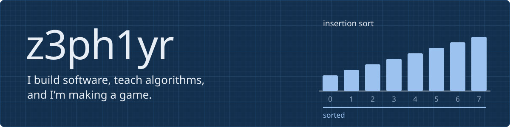

  

  

### 👋 About me

- 🛠️ I build software end to end: data pipelines, APIs and the interfaces people actually use
- 🎓 I teach **Data Structures & Algorithms** and **OOP** at university
- 🔒 Most of my work is client or commercial and lives in private repos. Happy to walk through any of it on a call

### 🧰 Tech I work with

  

### 🚀 Selected work

<table>
<tr>
<td width="50%" valign="top">

#### ⚖️ [LexIndia AI](https://github.com/z3ph1yr/lexindia-ai)
Grounded legal research over **933 provisions** of IPC 1860 and BNS 2023, each traceable to its source.

- Hybrid retrieval (citation, BM25, concept expansion, TF-IDF, embeddings) fused with RRF
- Every citation is checked against retrieved text; anything unverified is removed
- Weak queries are refused rather than guessed
- Zero-config, zero-API-cost mode · 47 tests

   

</td>
<td width="50%" valign="top">

#### 🧪 Lab test-report generator
*Freelance, for an electrical testing laboratory*

Manual entry → validated data → draft and final PDF reports.

- One shared core (domain model, validation, PDF engine) behind two apps
- Offline Windows desktop app, packaged as a portable .exe
- Multi-user web app with sign-in, per-user drafts and shared org defaults

  

</td>
</tr>
<tr>
<td width="50%" valign="top">

#### 📚 Interactive DSA learning platform
Algorithms run as instrumented reference code and replay step by step, with narration and synced pseudocode.

- Deterministic trace-replay engine and visualization core
- React player with playback controls and narration rail
- Content validator that checks the prerequisite graph between lessons

  

</td>
<td width="50%" valign="top">

#### 🎮 2v2 Runner/Gunner game
*In development*

A Hyrox-Doubles-style team game where one player runs and the other shoots.

<!-- gameplay GIF here -->

 

</td>
</tr>
</table>

### 🗺️ Currently designing

**Lab management + ERP:** enquiry → quotation → work order → testing → approval → report → GST invoice → payment

  

  

